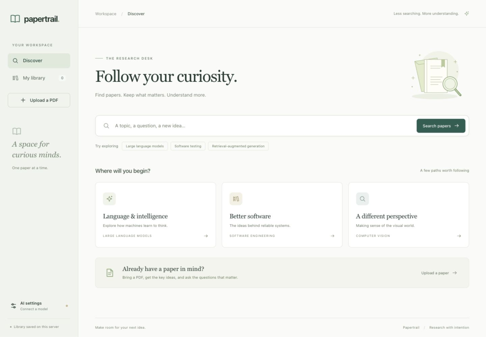

# Papertrail

**Find papers. Keep what matters. Understand more.**

A small AI research assistant for CS593 Homework 1. The interface uses warm white, muted sage, clear typography, and a responsive reading workspace.



## Run locally

Requires Python 3.11 or newer. No JavaScript build step is needed.

```bash
cd solutions/hw1
python3 -m venv .venv
source .venv/bin/activate
python -m pip install -r requirements.txt
test -f .env || cp .env.example .env
python app.py
```

Open **http://127.0.0.1:8000**. The configuration command preserves an existing `.env`. Windows PowerShell users should activate with `.venv\Scripts\Activate.ps1` and use `if (-not (Test-Path .env)) { Copy-Item .env.example .env }`.

Search, the local library, and PDF extraction work without a model key. To enable summaries and Q&A, edit `.env` and restart:

```dotenv
LLM_BASE_URL=https://api.openai.com/v1
LLM_API_KEY=your-key
LLM_MODEL=gpt-6-luna
LLM_REASONING_EFFORT=none
```

The model is configurable; use an exact model name available to your account. Other OpenAI-compatible services can use their own base URL, key, and model. The client calls `/chat/completions` with `messages` and `max_completion_tokens`. GPT-6 Luna uses `reasoning_effort=none` by default to preserve the focused, non-reasoning workload and limit token use. For a different model, set `LLM_REASONING_EFFORT` to a supported value or leave it blank. For local Ollama, use `http://localhost:11434/v1`, `LLM_API_KEY=ollama`, and an installed model with enough context for up to 48,000 characters plus instructions.

**Never commit credentials.** `.env`, runtime data, and virtual environments are ignored. The frontend never receives the API key. Hosted AI calls may incur provider charges. Repeated identical successful summaries and questions use saved results.

## Required features

| Requirement | How to use it |
| --- | --- |
| Search research papers | Use Discover to search arXiv by topic, keywords, or arXiv ID. Results show title, authors, first-publication year, abstract, and original link. Expand longer abstracts. Search supports relevance/newest sorting and pagination. |
| Save to a persistent library | Select **Save to library**, then browse **My library**. SQLite keeps papers and analyses across refreshes and process restarts. Filter by text/source or sort by date/title. |
| Upload PDF papers | Select **Upload a PDF**. Text, title, authors, publication year, and abstract are extracted; review and correct them in the details dialog. Duplicate uploads are detected by file hash. |
| Summarize with an LLM | Open a paper, choose **AI summary**, and select **Generate summary**. arXiv PDFs load automatically. The model receives extracted page text, with page references. |
| Ask questions | Use **Ask this paper** in the reading room. Questions, answers, model, source excerpts, and context coverage are saved with the paper. Page buttons jump to source text. |

Additional controls let you edit metadata, download saved PDFs, inspect source text, and remove a paper. The interface supports mobile screens, keyboard navigation, labeled forms, reduced motion, and actionable error states.

## Architecture

```text
Browser: HTML + CSS + vanilla JavaScript
                  |
             Flask JSON API
             /     |     \
       arXiv API  SQLite  OpenAI-compatible LLM API
             \     |     /
               PDF text
                (pypdf)
```

| Component | Responsibility |
| --- | --- |
| `app.py` | App factory, validation, library/upload/content/analysis endpoints, optional authentication |
| `database.py` | SQLite schema, transactions, JSON serialization |
| `providers.py` | arXiv search and bounded PDF download; LLM request handling |
| `pdf_tools.py` | PDF extraction, metadata fallback, context selection, citation checks |
| `templates/index.html` | App shell and accessible dialogs |
| `static/app.js` | Search/library/reading views, forms, navigation, API calls |
| `static/style.css` | Responsive sage-and-white interface |
| `tests/test_app.py` | Focused integration checks using temporary storage and mocked external services |
| `docs/` | Demo guidance, reflection draft, evidence, submission checklist |
| `data/` | Runtime SQLite database and content-addressed PDFs; excluded from Git |

`papers` stores metadata, extracted pages, and the PDF filename. `analyses` stores the summary/Q&A history and source evidence. SQL values are parameterized and foreign keys cascade analysis deletion. Identical file bytes can be shared by an arXiv download and an upload; deleting one record preserves a PDF still used by another.

### API overview

| Endpoint | Purpose |
| --- | --- |
| `GET /api/status` | Non-secret model configuration status |
| `GET /api/search?q=...&page=1&sort=relevance` | Search arXiv |
| `GET /api/papers` / `POST /api/papers` | Browse library / save a search result |
| `POST /api/upload` | Multipart PDF upload (`file` field) |
| `GET /api/papers/:id` | Metadata, full text, and analysis history |
| `PATCH /api/papers/:id` / `DELETE /api/papers/:id` | Edit metadata / remove paper |
| `POST /api/papers/:id/content` | Download and extract an arXiv PDF |
| `GET /api/papers/:id/pdf` | Download the stored PDF |
| `POST /api/papers/:id/analyze` | JSON `{ "kind": "summary" }` or `{ "kind": "question", "question": "..." }` |

## Grounding and limitations

- Summaries and answers use the paper's extracted text. They cannot run on title/metadata alone. A missing model produces a setup message, never a fabricated response.
- Papers fitting within the 48,000-character context budget use all extracted text. Longer summaries use excerpts spread across the paper; longer-paper questions use keyword-ranked excerpts and opening context. The displayed coverage makes this explicit. Retrieval is lexical, not semantic, and can miss evidence, particularly for cross-language questions.
- Prompts request page references and instruct the model to say when evidence is absent. The backend checks that cited page numbers were supplied. This detects invalid page numbers, **not** incorrect interpretations or hallucinations; inspect the excerpts and original paper.
- PDF uploads are limited to 20 MB, 150 pages, and one million extracted characters. Scans without readable text require OCR; this app does not perform OCR. Tables, equations, and unusual multi-column layouts may extract imperfectly.
- Metadata extraction is best effort. PDF metadata/text heuristics run first, including prominent title text and publication-context dates. If the PDF contains an arXiv identifier, the app retrieves matching bibliographic metadata. Otherwise, a configured LLM can improve title, authors, year, and abstract from the first two pages. Unknown fields remain blank and all fields are editable. First arXiv publication year can differ from journal/conference year.
- arXiv is an external service. Searches are spaced at least 3.1 seconds apart and cached for ten minutes per process. Common English stop words are omitted from keyword matching. IDs are useful for finding an exact known paper.
- Analysis cache keys include the paper text, task, model, endpoint, and output configuration. Identical successful requests are reused across restarts. Editing metadata does not invalidate an analysis because the analysis prompt uses PDF text rather than edited metadata.
- Uploaded PDFs and analyses stay in `DATA_DIR`. When AI is enabled, the relevant PDF text is sent to the configured provider. The app has one shared library and no multi-user isolation.

## Configuration

| Variable | Default | Meaning |
| --- | --- | --- |
| `LLM_BASE_URL` | `https://api.openai.com/v1` | Compatible API endpoint |
| `LLM_API_KEY` | empty | Server-side key; `OPENAI_API_KEY` is a fallback |
| `LLM_MODEL` | `gpt-6-luna` | Exact model name |
| `LLM_MAX_OUTPUT_TOKENS` | `1800` | Response token cap, including any reasoning tokens |
| `LLM_REASONING_EFFORT` | `none` for GPT-6 Luna | Optional model-supported reasoning setting; blank also resolves to `none` for Luna |
| `LLM_TIMEOUT` | `120` | Model response timeout in seconds |
| `DATA_DIR` | `data` | Persistent data directory, relative to app root or absolute |
| `HOST` / `PORT` | `127.0.0.1` / `8000` | Development server address |
| `APP_USERNAME` / `APP_PASSWORD` | empty | Optional Basic authentication; set both together |

If a response hits its output cap, the app reports it and does not save a truncated answer. Increase `LLM_MAX_OUTPUT_TOKENS` if needed. Do not add unsupported reasoning parameters for a model that does not accept them.

## Verification

```bash
python -m unittest discover -s tests -v
```

The focused checks cover restart persistence, deduplication, metadata editing, invalid PDFs, full-text grounding, saved Q&A and response reuse, citation warnings, shared-file deletion, context selection, search query construction, provider errors, and origin checks. Network/model responses in automated tests are mocked; live browser evidence is recorded separately in [VERIFICATION.md](docs/VERIFICATION.md).

On October 9, the README installation was repeated in a fresh Python 3.11 environment with a blank example configuration and a new database. All 14 tests and the dependency check passed. Real HTTP checks confirmed startup, static assets, PDF upload, the missing-key message, and persistence after restarting the process. arXiv returned HTTP 429 during that day's live search check; the app displayed its service-unavailable message. Upload and local library access remain available during a search-service outage.

## Deployment

For a local demonstration on macOS, Windows, or Linux, `python app.py` is sufficient. For a persistent Linux server, use:

```bash
gunicorn --workers 1 --threads 4 --timeout 180 --bind 127.0.0.1:8000 'app:create_app()'
```

One worker keeps search throttling, analysis serialization, and file coordination consistent. Use a persistent `DATA_DIR`. For public hosting, set both authentication variables and put a reverse proxy with HTTPS in front. This assignment app is designed for a trusted single user, not untrusted public uploads at scale.

With Docker installed:

```bash
docker compose up --build -d
```

Compose binds to localhost and stores the library in a persistent named volume. `docker compose down` stops it; adding `-v` also deletes the library. Configure `.env` first. The localhost Ollama example is for native execution; a container needs an endpoint that can reach the host.

No cloud deployment is implied by these configuration files. See the verification record for what actually ran.

On macOS, use the local development command for the demo. A Gunicorn reload triggered a macOS Objective-C fork error during verification; the Linux container/server configuration avoids that platform-specific process model.

## Submission

The assignment requires a repository link, a short demo of all five flows, and a personal reflection with genuine interaction screenshots. Begin with [SUBMISSION_CHECKLIST.md](docs/SUBMISSION_CHECKLIST.md). [DEMO_SCRIPT.md](docs/DEMO_SCRIPT.md) provides a recording plan. [REFLECTION.md](docs/REFLECTION.md) incorporates the student's October 9 account with agent-assisted editing and distinguishes personal functional review from agent-run verification.

Repository: [VichyTong/CS593-ASE](https://github.com/VichyTong/CS593-ASE). Confirm that the grader has access: an unauthenticated check returned 404 on October 9, so public accessibility is not established.

Submission materials: [Overleaf report](https://www.overleaf.com/project/6ac7d8e49907ab7405d67d38), [compiled report](docs/reflection.pdf), and [88-second five-flow demo](docs/demo.mp4). Use Overleaf for later report edits; `docs/overleaf-report.tex` is its local source mirror, and `reflection-overleaf.pdf` is an identical local PDF copy. The captioned walkthrough uses actual browser screenshots, including a real `gpt-6-luna` summary and question response verified October 4. It is a screenshot sequence rather than a continuous screen recording. The report includes three genuine chat screenshots: Figures 2 and 3 connect the unfinished AI setup to the student's API configuration and model choice, followed by real verification. They do not show the separate search/metadata debugging exchanges. Read the final report before submission. [SUBMIT.txt](docs/SUBMIT.txt) lists the exact submission items and remaining steps.

Optional legacy tools can rebuild a separate Markdown-based review draft and the captioned video. They do not update Overleaf or the final `reflection.pdf`. These tools are separate from the application:

```bash
python -m pip install reportlab imageio-ffmpeg pillow
python tools/build_submission.py --complete-demo
```

The live AI evidence is saved as `docs/evidence/06-summary.jpg`, `07-question.jpg`, and `live-ai-verification.json`. Running without `--complete-demo` rebuilds the older incomplete preview. Review the generated video and PDF before submission; the tool does not create chat screenshots or invent model results.

The reflection's application evidence is embedded from [a vector PDF](docs/evidence/application-evidence.pdf), so its text stays selectable and sharp when enlarged. Page 1 is a labeled transcription of the historical metadata failure; page 2 renders the actual metadata HTML/CSS with the saved paper record in a print layout. Original chat screenshots remain unchanged. To regenerate the application evidence from a local library record without operating any desktop browser:

```bash
python tools/render_application_evidence.py --paper-id 2
python -c 'from tools.build_submission import build_pdf; build_pdf()'
```

This uses an isolated headless Chromium process and local, script-free HTML. Pass `--chromium /path/to/chromium` or `--database /path/to/library.sqlite3` when needed. The generated `application-evidence.html` is also retained; no new model requests are made. The report builder merges the PDF drawing instructions directly, without converting them to images.

## Primary documentation

- [arXiv API manual](https://info.arxiv.org/help/api/user-manual.html)
- [Flask documentation](https://flask.palletsprojects.com/en/stable/)
- [pypdf text extraction](https://pypdf.readthedocs.io/en/stable/user/extract-text.html)
- [OpenAI Chat Completions API](https://developers.openai.com/api/reference/resources/chat/subresources/completions/methods/create)
- [GPT-6 Luna API model](https://developers.openai.com/api/docs/models/gpt-6-luna)

Developed with Codex, including requirements review, design, implementation, testing, debugging, and documentation. See the reflection for the division of responsibilities and the limits of the evidence.
