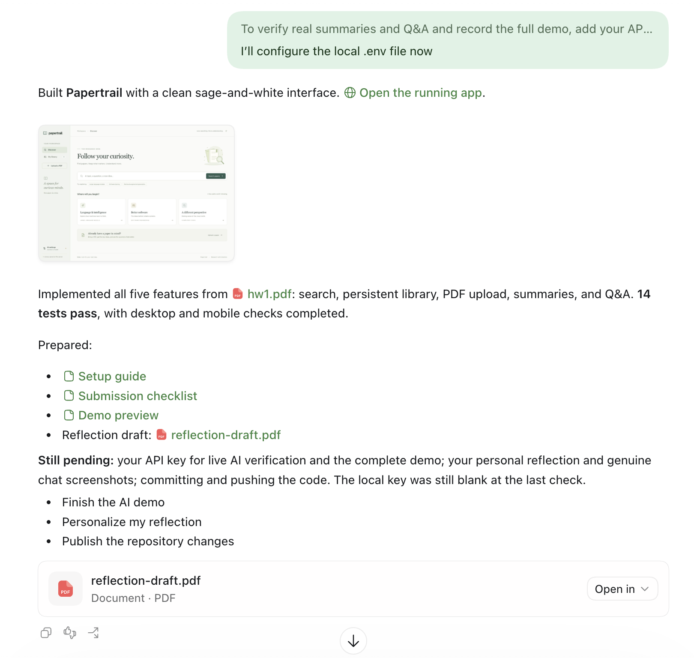
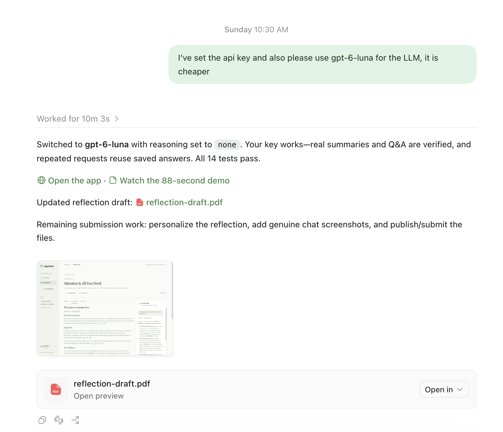

# Reflection on building Papertrail with Codex

I used Codex to build Papertrail, an AI research assistant for finding papers, keeping a local library, uploading PDFs, and using an LLM to summarize and question their contents. This report was prepared with Codex assistance using my personal reflection supplied on October 9 and the recorded development work. The personal experience and the agent's technical checks are identified separately below.

## 1. Choosing and using Codex

I chose Codex because I liked its user interface and found the newer models useful. My initial request was short: read the assignment, help complete its requirements, and give the frontend clean colors and a concise style. I provided the assignment rather than a detailed implementation plan. Codex then worked through the frontend, backend, external services, persistence, PDF processing, verification, and documentation.

The resulting application uses Flask, SQLite, pypdf, the arXiv API, and an OpenAI-compatible LLM API, with HTML, CSS, and JavaScript for the frontend. Papertrail has a light sage-and-white interface with discovery, library, and reading views. The agent selected and connected these components; my instructions supplied the task, visual direction, and later model choice.

What surprised me most was its ability to keep working on a long task. Beyond the assignment itself, I had given only a brief description of my preferences, yet the first run continued for almost an hour. Seeing a short request lead to sustained implementation and checking was more striking to me than any individual generated function. That duration does not establish correctness by itself, but it changed my impression of how much work an agent can carry through from one instruction.

## 2. Where the agent was useful

The clearest contribution was connecting the required features into one usable workflow. A search result needs metadata and a durable library record. A saved or uploaded paper needs extracted text before the model can analyze it. The interface also needs to show progress, errors, saved answers, and a path back to the source. Codex handled those connections across multiple files rather than leaving me with separate feature demonstrations.

The content-grounding requirement was especially important. The application sends extracted PDF text to the model, keeps physical PDF page numbers, and saves answers with source excerpts. It uses the full text when it fits the context budget and labels the use of excerpts for longer papers. These choices make an answer easier to inspect, although page references do not guarantee a correct interpretation.

Persistence was another useful part of the implementation. SQLite stores papers and analysis history, file hashes detect duplicate uploads, and repeated identical successful analysis requests reuse saved responses. The agent also checked a less visible case: deleting one record should preserve PDF bytes that another record still uses. This illustrates the integration work behind a simple-looking interface.

## 3. Failures, incomplete results, and corrections

### A. Search and PDF metadata needed real examples

The initial search required every word in a query. The natural title `attention is all you need` returned no results during verification, while the arXiv ID `1706.03762` found the paper. Codex changed the query construction to omit common English stop words and added a regression check. The resulting keyword search is broader than an exact-title lookup, so the ID remains useful for retrieving a known paper.

Uploading the real PDF exposed a second problem. The parser chose a reproduction notice as the title, left the authors empty, and selected 2014 from a dataset reference as the publication year. Earlier checks with a simple synthetic PDF had not exposed this. Codex added identifier-based arXiv metadata enrichment, improved title and publication-year heuristics, and retained an editable review form. The corrected example shows the proper title, eight authors, 2017, and abstract in Evidence B.

These repairs were found and carried out by the agent during its checks. I do not attribute those individual diagnoses to myself. Evidence A preserves the visible failed metadata as a labeled transcription, and the original before/after captures are retained in the evidence folder. The three conversation screenshots document the initial request and the AI setup/model follow-up; they do not show the internal search or metadata debugging exchanges.

The important limitation is that a clean test fixture did not represent the structure of an actual research paper. Notices, footnotes, columns, and dataset years all complicated extraction. Testing a representative document revealed problems that a successful basic upload test could not rule out.

### B. The first delivery still needed a working AI connection

The initial delivery reported that the five features had been implemented, but live summaries and Q&A still depended on my API configuration. Figure 2 shows this unfinished step and my response that I would configure the local `.env` file. I then supplied the key locally and explicitly asked for `gpt-6-luna` because it was cheaper. Figure 3 shows that instruction and the agent's subsequent report of successful real summaries, Q&A, saved-result reuse, and 14 passing tests.

This was a concrete case where a delivered implementation still needed my input before the complete workflow could be verified. The follow-up changed both the model configuration and what could be tested. It also showed that credentials and model choice are requirements to settle early, rather than details to discover at the end. The API key stayed in an ignored local file.

### C. I redirected the report-rendering approach

Some of my later corrections concerned the presentation of the results. The PNG application figures were not clear enough, so I asked for PDF or SVG. When saving the PDF through computer use kept failing, I specifically asked the agent to stop using computer use and render from HTML. It produced a vector PDF from the application's HTML/CSS and saved paper data. I then requested black report text.

These instructions named an observable problem, a desired output, and a constraint on the method. The application figures now retain selectable text when enlarged. The historical failure page is explicitly a transcription, while the corrected metadata page is a direct HTML/CSS rendering with a print layout that exposes all authors and the abstract. The original conversation screenshots remain unchanged. These later corrections are part of the conversation record, but are not shown in the three supplied screenshots.

## 4. My review and the agent's verification

I personally tried all five required functions: searching for papers, saving them to the library, uploading a PDF, generating a summary, and asking questions. This is the review I can report directly from my own experience. The detailed code repairs, automated checks, and process-level persistence checks described here were performed by Codex. I separate my functional review from those checks rather than presenting the agent's work as my own manual debugging.

Fourteen automated tests passed after the corrections. They use temporary databases and mocked external responses. Separate live checks on October 4 established that `gpt-6-luna` could produce a real summary and answer from the paper content, and that repeated requests reused saved results. A grouped-page-reference format in the answer also exposed a frontend linking gap that Codex repaired.

On October 9, Codex repeated the README setup in a fresh Python environment with the example configuration and a new database. Dependency checks and all 14 tests passed. Actual HTTP checks confirmed startup, upload, the missing-key message, and data persistence after a process restart. That day's live arXiv request returned HTTP 429, a rate limit, so the app displayed its service-unavailable message. This is recorded separately from the earlier successful search checks; passing mocked tests does not establish that an external service is available at a particular moment.

The remaining limitations are practical ones. Metadata can still require correction, long-paper excerpt selection can omit relevant information, and valid page numbers do not prove that an answer accurately represents a paper. The local workflow was verified; a cloud deployment or Docker run is not claimed.

## 5. What I learned and what I would change

A short description of the desired result gave the agent enough direction to begin a substantial task. My preference for concise design and clean colors influenced the interface, and the nearly hour-long first run demonstrated sustained execution across many steps. At the same time, I still needed to make decisions, try the application, and correct outputs that did not meet my expectations.

If I started again, I would prepare the API access and choose the model before asking for the implementation. In this project those decisions came later, after an initial delivery. Stating them at the beginning would make the cost constraint and the requirements for live verification clear from the outset. I would keep the key in local configuration and specify the model explicitly, as I eventually did with `gpt-6-luna`.

I would also make acceptance criteria more concrete: the five working flows, persistent saved data, answers based on the uploaded paper, and readable report figures. My request to render from HTML was more actionable than simply saying the PDF was bad. The experience showed me that an agent can sustain a large amount of work, while I remain responsible for setting its direction and checking whether the result meets the task.

<!-- pagebreak -->

## Figure 2. Initial delivery and the unfinished AI setup

This exchange records my response that I would configure the local `.env` file and Codex's initial delivery. The message identifies live AI verification as pending. It provides the context for the concrete configuration and model-selection follow-up in Figure 3.

<!-- pagebreak -->

## Figure 3. My model instruction and the verified follow-up

I confirmed that the API key was configured and requested `gpt-6-luna` for lower cost. The reply reports the model change, real summary and Q&A verification, saved-answer reuse, and passing tests. Together with Figure 2, this shows an incomplete integration step, my follow-up input, and the agent's reported result.

